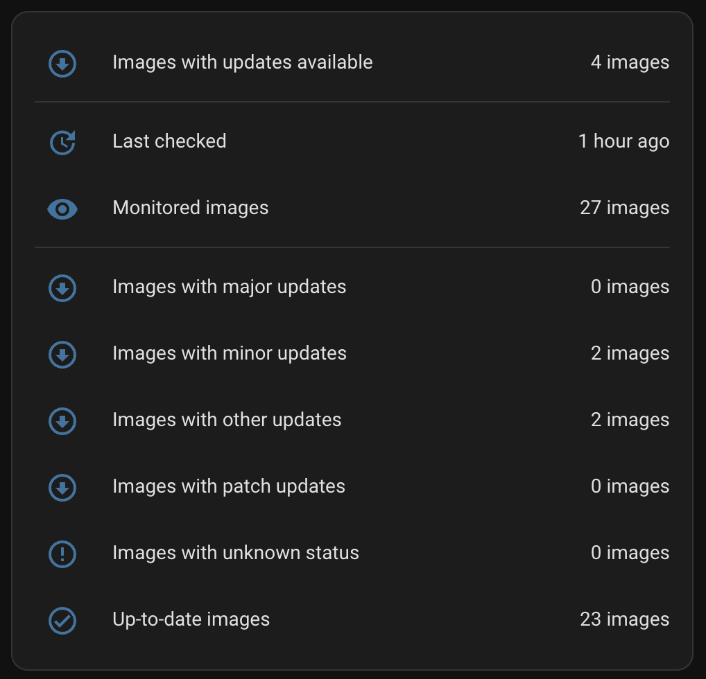

# HA Cup Component for Home Assistant

[](https://github.com/bastgau)
[](https://www.python.org/)
[](https://www.home-assistant.io/)
[](https://github.com/bastgau/ha-cup-component/releases)
[](https://github.com/bastgau/ha-cup-component/actions/workflows/validate-for-hacs.yml)
[](https://github.com/bastgau/ha-cup-component/actions/workflows/validate-with-hassfest.yml)

<p align="center" width="192">
    
</p>

## Description

To use this integration, you need to install Cup from [https://cup.sergi0g.dev](https://cup.sergi0g.dev).

The **HA Cup Component** integration for Home Assistant allows you to retrieve update statistics for Docker containers directly from your Home Assistant interface.

With this integration, you can easily track the status of your Docker containers and receive notifications when updates are available.

The following sensors are currently implemented :

<p align="center" width="100%">
    
</p>

### Update entities

The integration can also create one `update` entity per monitored image, so that each pending image update appears in **Settings > Updates**. This is off by default: turn on **Create an update entity for each image** when adding the integration, or later in its options. Turning it off removes these entities.

- Images matching an exclusion pattern get no update entity.
- An image checked on a Cup agent gets its own entity, named after the image and the agent.
- The entity shows the current and new version, or the short digests for a digest update.
- Cup does not provide release notes: the link is the project URL from the image's `org.opencontainers.image.url` label, when it has one.
- Cup only checks for updates, so they cannot be installed from Home Assistant.

## Translation

The integration is currently translated in few langages :

- English
- French

## Installation

### Installation via HACS

1. Add this repository as a custom repository to HACS:

[](https://my.home-assistant.io/redirect/hacs_repository/?owner=bastgau&repository=ha-cup-component&category=Integration)

2. Use HACS to install the integration.
3. Restart Home Assistant.
4. Set up the integration using the UI:

[](https://my.home-assistant.io/redirect/config_flow_start/?domain=cup_component)

### Manual Installation

1. Download the integration files from the GitHub repository.
2. Place the integration folder in the custom_components directory of Home Assistant.
3. Restart Home Assistant.
4. Set up the integration using the UI:

[](https://my.home-assistant.io/redirect/config_flow_start/?domain=cup_component)

## Troubleshooting

If you are having issues connecting, make sure you can successfully connect to http(s)://\<url\>:\<port\>/api/v3/json using a private browser window.

There have also been reports of non-ssl instances not being entirely reliable. It is recommended to use a valid SSL certificate.

## Debugging

It is possible to show the info and debug logs for the Cup Component integration, to do this you need to enable logging in the configuration.yaml, example below:

```
logger:
  default: warning
  logs:
    # Log for Cup Component integration
    custom_components.cup_component: debug
```

Logs do not remove sensitive information so careful what you share, check what you are about to share and blank identifying information.

## Support & Contributions

If you encounter any issues or wish to contribute to improving this integration, feel free to open an issue or a pull request on the GitHub repository.

[](https://www.buymeacoffee.com/bastgau)

Enjoy!
